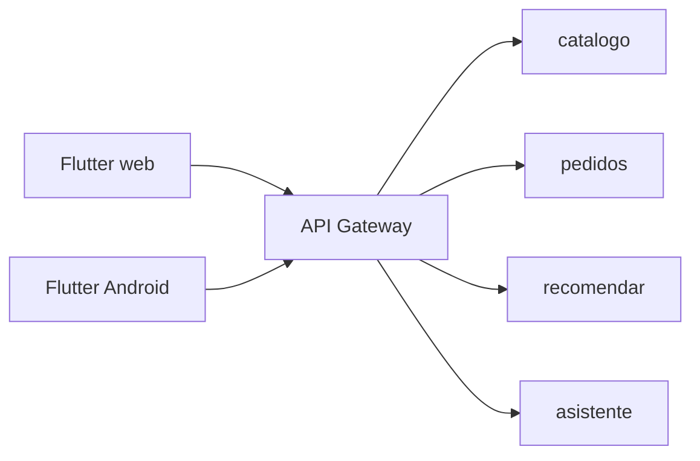

# Arquitectura

> **Decisión:** APROBADA — microservicios con API Gateway.
> **Detalles de implementación:** PENDIENTES DE DOCUMENTAR por el equipo mediante PR.

## 1. Decisión

El sistema se construye con **microservicios detrás de un API Gateway**:

- Cada área funcional es un microservicio independiente dentro de `services/`:
  `catalogo`, `pedidos`, `recomendar` y `asistente`.
- El **API Gateway** (`gateway/`) es el único punto de entrada para los clientes.
- La aplicación **Flutter** (`app_flutter/`) usa el mismo código en web y Android y
  se comunica **solo** con el gateway, nunca con las direcciones internas de los servicios.

## 2. Justificación

<!-- Pendiente: razones del equipo para esta arquitectura en el contexto del proyecto -->

## 3. Componentes

| Componente | Carpeta | Responsabilidad | Tecnología | Responsable |
|---|---|---|---|---|
| API Gateway | `gateway/` | Punto único de entrada y enrutamiento | _pendiente_ | _pendiente_ |
| Catálogo | `services/catalogo/` | Explorar y buscar en el catálogo | _pendiente_ | _pendiente_ |
| Pedidos | `services/pedidos/` | Registrar pedidos y consultarlos por folio | _pendiente_ | _pendiente_ |
| Recomendar | `services/recomendar/` | Recomendador (IA 1) | _pendiente_ | _pendiente_ |
| Asistente | `services/asistente/` | Asistente del comprador (IA 2) | _pendiente_ | _pendiente_ |
| App Flutter | `app_flutter/` | Cliente web y Android | Flutter | _pendiente_ |
| Infraestructura | `infra/` | Entorno local y soporte | _pendiente_ | _pendiente_ |

## 4. Diagrama



<!-- Pendiente: completar con los detalles de implementación cuando se definan -->

## 5. Detalles de implementación pendientes

| Tema | Estado |
|---|---|
| Tecnología del gateway y reglas de enrutamiento | Propuesto (ver [5.1](#51-gateway-y-servicios)) |
| Tecnología de cada microservicio | Propuesto (ver [5.1](#51-gateway-y-servicios)) |
| Comunicación entre servicios (si la hay) | _pendiente_ |
| Diseño de persistencia | Implementado (ver [5.2](#52-diseño-de-persistencia)) |
| Orquestación del entorno local | _pendiente_ |
| Comportamiento ante fallos parciales y cómo se demostrará | Implementado (ver [5.3](#53-fallos-parciales)) |
| Contratos de API | ver [api.md](api.md) |

### 5.1 Gateway y servicios

**Estado:** Propuesto.

- **Gateway:** nginx. Es el único contenedor publicado hacia el anfitrión (puerto `8080`).
  Enruta por prefijo: `/api/catalogo/` → `catalogo:8000`, `/api/pedidos/` → `pedidos:8000`,
  `/api/recomendar/` → `recomendar:8000`, `/api/asistente/` → `asistente:8000`.
  Conserva la ruta completa, aplica un tiempo límite a cada servicio y, si el servicio no
  responde, devuelve `503` con el formato de error único de [api.md](api.md).
  También se encarga de CORS para Flutter web.
- **Servicios:** Python 3.12 + Django 5, sin Django REST Framework. Cada uno es un proyecto
  Django independiente en su propio contenedor, escuchando en el puerto `8000` interno.
  No se importan código entre sí; si uno necesita a otro, lo llama por HTTP con tiempo
  límite y manejo de error.

### 5.2 Diseño de persistencia

**Estado:** Implementado (etapa 11).

- Un solo servidor **PostgreSQL 16** (un contenedor) con **una base de datos por servicio**:
  `catalogo`, `pedidos`, `recomendar` y `asistente`. Se crean solo las que el servicio use.
- Cada servicio tiene su propio usuario de base de datos con permisos únicamente sobre su base.
  Ningún servicio lee ni escribe la base de otro: si necesita esos datos, los pide por HTTP.
- Las tablas de cada servicio se crean con las migraciones de Django de ese servicio.
- Los datos de conexión llegan por variables de entorno; en el repositorio solo hay
  `.env.example` con valores de ejemplo.
- En etapas tempranas se permite SQLite solo para correr un servicio suelto.
- Los modelos de IA (`.joblib`) no se guardan en la base de datos; los carga su servicio.
- Riesgo conocido: un solo servidor PostgreSQL es un punto único de falla para los servicios
  que usan base de datos. Se acepta por ser un entorno académico local.

**Cómo quedó en Docker Compose:**

- Los cuatro servicios se conectan a PostgreSQL (`DB_HOST=postgres`), cada uno a su base y con
  su usuario. Ninguno usa SQLite dentro de Compose: SQLite queda solo para correr un servicio
  suelto sin `DB_NAME`.
- Las bases y usuarios los crea `infra/postgres/01-crear-bases.sh` la primera vez que arranca el
  volumen `pgdata`. Cada usuario no tiene `CONNECT` sobre las bases de los demás.
- Cada servicio aplica sus migraciones al iniciar. `catalogo` además carga sus datos iniciales
  (`catalogo_inicial.json`) de forma idempotente. `recomendar` y `asistente` no tienen modelos
  todavía; corren `migrate` igual para quedar listos.
- Los datos sobreviven a reinicios de contenedores; solo se pierden con `docker compose down -v`.
  Procedimiento de comprobación en [infra/README.md](../infra/README.md#comprobar-la-persistencia).

### 5.3 Fallos parciales

**Estado:** Implementado (etapa 12). Comprobado el 2026-11-23 con
[`scripts/demo_fallo_parcial.sh`](../scripts/demo_fallo_parcial.sh).

Objetivo: demostrar que un servicio caído no tumba a los demás.

**Cómo se logra**

- El gateway resuelve el nombre de cada servicio en cada petición. Si no puede hablar con él
  (apagado, sin DNS o sin respuesta a tiempo), **solo esa ruta** responde `503` con
  `{"error": "servicio_no_disponible", "detalle": "El servicio <servicio> no respondió"}`.
  Ver [gateway/README.md](../gateway/README.md#servicio-no-disponible).
- Las llamadas entre servicios llevan tiempo límite: `pedidos → catalogo` (al registrar un
  pedido) responde `503` si `catalogo` no contesta; `asistente → pedidos` y
  `asistente → recomendar` responden `200` con un texto que avisa del problema (contrato en
  [api.md](api.md), "Cuando un servicio dependiente está caído").
- Al volver a encender el servicio, el gateway lo encuentra solo; no se reinicia nada más.

**Demo**

Desde la raíz, con todo levantado (`docker compose up -d`):

```bash
./scripts/demo_fallo_parcial.sh             # apaga recomendar (demo principal)
./scripts/demo_fallo_parcial.sh catalogo    # o cualquier otro servicio
```

El script comprueba que los cuatro servicios estén sanos, registra un pedido de prueba para
tener un folio, apaga el servicio, prueba por el gateway la salud de los cuatro, el catálogo,
la consulta por folio, el registro de un pedido, la recomendación y tres mensajes del chat,
y vuelve a encender el servicio (aunque el script se interrumpa) esperando su `200`.

**Qué sigue funcionando y qué no**

Resultados reales del script (código HTTP por el gateway). ✅ funciona normal,
⚠️ responde `200` pero avisa que no pudo completar, ❌ responde `503`.

| Operación | `recomendar` caído | `catalogo` caído | `pedidos` caído | `asistente` caído |
|---|---|---|---|---|
| Buscar en el catálogo `GET /api/catalogo/medios/?q=moto` | ✅ 200 | ❌ 503 | ✅ 200 | ✅ 200 |
| Consultar por folio `GET /api/pedidos/<folio>/` | ✅ 200 | ✅ 200 | ❌ 503 | ✅ 200 |
| Registrar pedido `POST /api/pedidos/` | ✅ 201 | ❌ 503 (lo da `pedidos`) | ❌ 503 | ✅ 201 |
| Recomendación `POST /api/recomendar/` | ❌ 503 | ✅ 200 | ✅ 200 | ✅ 200 |
| Chat: saludo | ✅ 200 | ✅ 200 | ✅ 200 | ❌ 503 |
| Chat: rastrear (consulta `pedidos`) | ✅ 200 | ✅ 200 | ⚠️ 200 | ❌ 503 |
| Chat: recomendar (consulta `recomendar`) | ⚠️ 200 | ✅ 200 | ✅ 200 | ❌ 503 |
| Salud de los otros tres servicios | ✅ 200 | ✅ 200 | ✅ 200 | ✅ 200 |
| Se recupera al encenderlo | ✅ | ✅ | ✅ | ✅ |

Notas de la evidencia:

- El `503` del gateway llega en 2 a 3 s: es el `resolver_timeout` de 2 s al no encontrar el
  contenedor apagado. Ninguna petición se quedó colgada.
- Con `catalogo` caído, registrar un pedido tarda unos 4 s y responde
  `{"error": "servicio_no_disponible", "detalle": "El servicio catalogo no respondió"}`
  desde `pedidos` (su cliente HTTP hacia `catalogo` tiene tiempo límite). La consulta por folio
  no depende de `catalogo` y sigue igual.
- Las respuestas ⚠️ del chat tardan 3 s (tiempo límite del asistente hacia el otro servicio).
- `catalogo` caído no afecta al chat ni a `recomendar`: ninguno de los dos lo consulta.

Salida real con `recomendar` apagado (cuerpos recortados):

```
=== Pruebas con recomendar apagado ===
> Salud de recomendar
  GET /api/recomendar/health/ -> HTTP 503 (3.01 s)
  {"error": "servicio_no_disponible", "detalle": "El servicio recomendar no respondió"}
> Catálogo: buscar medios
  GET /api/catalogo/medios/?q=moto -> HTTP 200 (0.04 s)
  {"medios": [{"clave": "motocicleta", "nombre": "Motocicleta", ...}]}
> Consulta por folio
  GET /api/pedidos/PQ-20261123-VYZH/ -> HTTP 200 (0.02 s)
  {"folio": "PQ-20261123-VYZH", "estado": "CREADO", "medio": "motocicleta", ...}
> Recomendación directa
  POST /api/recomendar/ -> HTTP 503 (2.01 s)
  {"error": "servicio_no_disponible", "detalle": "El servicio recomendar no respondió"}
> Chat: rastrear (usa pedidos)
  POST /api/asistente/ -> HTTP 200 (0.02 s)
  {"intencion": "rastrear", "respuesta": "Tu pedido PQ-20261123-VYZH está registrado y todavía no sale (CREADO). ..."}
> Chat: recomendar (usa recomendar)
  POST /api/asistente/ -> HTTP 200 (3.01 s)
  {"intencion": "recomendar", "respuesta": "En este momento no puedo calcular una recomendación. Intenta de nuevo en unos minutos."}

=== Encendiendo recomendar otra vez ===
recomendar volvió a responder 200 sin reiniciar los demás.
```

Pendiente para la demo completa: comprobar en la app Flutter que la pantalla de
recomendación muestra el error y las demás siguen funcionando. El script solo prueba la API.

## 6. Web y móvil

| Aspecto | Web | Android |
|---|---|---|
| URL base del gateway | _pendiente_ | _pendiente_ |
| Empaquetado | _pendiente_ | _pendiente_ |
| Restricciones de plataforma | _pendiente_ | _pendiente_ |
