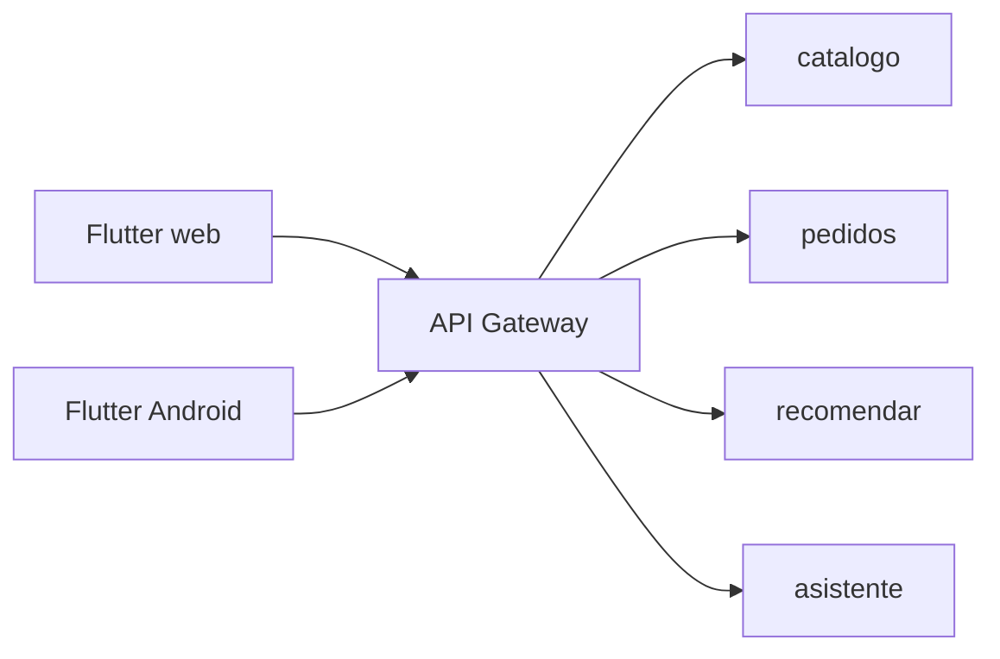

# Arquitectura

> **Decisión:** APROBADA — microservicios con API Gateway.
> **Detalles de implementación:** PENDIENTES DE DOCUMENTAR por el equipo mediante PR.

## 1. Decisión

El sistema se construye con **microservicios detrás de un API Gateway**:

- Cada área funcional es un microservicio independiente dentro de `services/`:
  `catalogo`, `pedidos`, `recomendar` y `asistente`.
- El **API Gateway** (`gateway/`) es el único punto de entrada para los clientes.
- La aplicación **Flutter** (`app_flutter/`) usa el mismo código en web y Android y
  se comunica **solo** con el gateway, nunca con las direcciones internas de los servicios.

## 2. Justificación

<!-- Pendiente: razones del equipo para esta arquitectura en el contexto del proyecto -->

## 3. Componentes

| Componente | Carpeta | Responsabilidad | Tecnología | Responsable |
|---|---|---|---|---|
| API Gateway | `gateway/` | Punto único de entrada y enrutamiento | _pendiente_ | _pendiente_ |
| Catálogo | `services/catalogo/` | Explorar y buscar en el catálogo | _pendiente_ | _pendiente_ |
| Pedidos | `services/pedidos/` | Registrar pedidos y consultarlos por folio | _pendiente_ | _pendiente_ |
| Recomendar | `services/recomendar/` | Recomendador (IA 1) | _pendiente_ | _pendiente_ |
| Asistente | `services/asistente/` | Asistente del comprador (IA 2) | _pendiente_ | _pendiente_ |
| App Flutter | `app_flutter/` | Cliente web y Android | Flutter | _pendiente_ |
| Infraestructura | `infra/` | Entorno local y soporte | _pendiente_ | _pendiente_ |

## 4. Diagrama

<!-- Pendiente: completar con los detalles de implementación cuando se definan -->

## 5. Detalles de implementación pendientes

| Tema | Estado |
|---|---|
| Tecnología del gateway y reglas de enrutamiento | _pendiente_ |
| Tecnología de cada microservicio | _pendiente_ |
| Comunicación entre servicios (si la hay) | _pendiente_ |
| Diseño de persistencia | _pendiente_ |
| Orquestación del entorno local | _pendiente_ |
| Comportamiento ante fallos parciales y cómo se demostrará | _pendiente_ |
| Contratos de API | ver [api.md](api.md) |

## 6. Web y móvil

| Aspecto | Web | Android |
|---|---|---|
| URL base del gateway | _pendiente_ | _pendiente_ |
| Empaquetado | _pendiente_ | _pendiente_ |
| Restricciones de plataforma | _pendiente_ | _pendiente_ |
