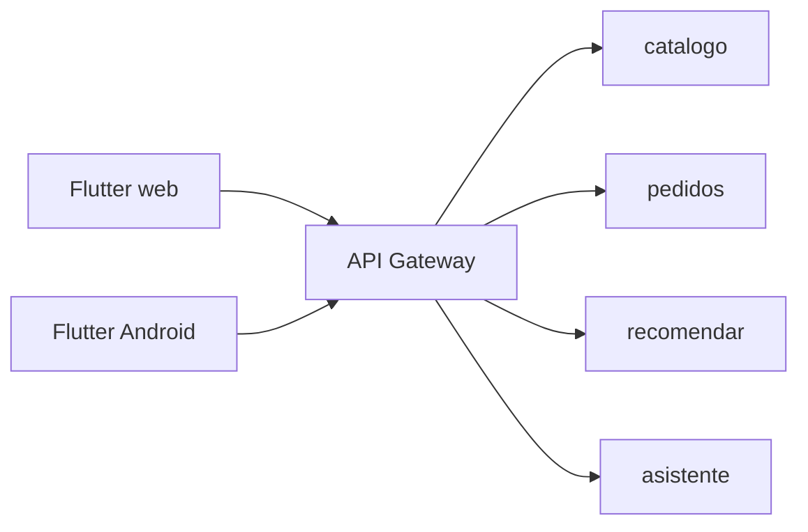

# Arquitectura

> **Decisión:** APROBADA — microservicios con API Gateway.
> **Detalles de implementación:** PENDIENTES DE DOCUMENTAR por el equipo mediante PR.

## 1. Decisión

El sistema se construye con **microservicios detrás de un API Gateway**:

- Cada área funcional es un microservicio independiente dentro de `services/`:
  `catalogo`, `pedidos`, `recomendar` y `asistente`.
- El **API Gateway** (`gateway/`) es el único punto de entrada para los clientes.
- La aplicación **Flutter** (`app_flutter/`) usa el mismo código en web y Android y
  se comunica **solo** con el gateway, nunca con las direcciones internas de los servicios.

## 2. Justificación

<!-- Pendiente: razones del equipo para esta arquitectura en el contexto del proyecto -->

## 3. Componentes

| Componente | Carpeta | Responsabilidad | Tecnología | Responsable |
|---|---|---|---|---|
| API Gateway | `gateway/` | Punto único de entrada y enrutamiento | _pendiente_ | _pendiente_ |
| Catálogo | `services/catalogo/` | Explorar y buscar en el catálogo | _pendiente_ | _pendiente_ |
| Pedidos | `services/pedidos/` | Registrar pedidos y consultarlos por folio | _pendiente_ | _pendiente_ |
| Recomendar | `services/recomendar/` | Recomendador (IA 1) | _pendiente_ | _pendiente_ |
| Asistente | `services/asistente/` | Asistente del comprador (IA 2) | _pendiente_ | _pendiente_ |
| App Flutter | `app_flutter/` | Cliente web y Android | Flutter | _pendiente_ |
| Infraestructura | `infra/` | Entorno local y soporte | _pendiente_ | _pendiente_ |

## 4. Diagrama

<!-- Pendiente: completar con los detalles de implementación cuando se definan -->

## 5. Detalles de implementación pendientes

| Tema | Estado |
|---|---|
| Tecnología del gateway y reglas de enrutamiento | Propuesto (ver [5.1](#51-gateway-y-servicios)) |
| Tecnología de cada microservicio | Propuesto (ver [5.1](#51-gateway-y-servicios)) |
| Comunicación entre servicios (si la hay) | _pendiente_ |
| Diseño de persistencia | Propuesto (ver [5.2](#52-diseño-de-persistencia)) |
| Orquestación del entorno local | _pendiente_ |
| Comportamiento ante fallos parciales y cómo se demostrará | Propuesto (ver [5.3](#53-fallo-parcial)) |
| Contratos de API | ver [api.md](api.md) |

### 5.1 Gateway y servicios

**Estado:** Propuesto.

- **Gateway:** nginx. Es el único contenedor publicado hacia el anfitrión (puerto `8080`).
  Enruta por prefijo: `/api/catalogo/` → `catalogo:8000`, `/api/pedidos/` → `pedidos:8000`,
  `/api/recomendar/` → `recomendar:8000`, `/api/asistente/` → `asistente:8000`.
  Conserva la ruta completa, aplica un tiempo límite a cada servicio y, si el servicio no
  responde, devuelve `503` con el formato de error único de [api.md](api.md).
  También se encarga de CORS para Flutter web.
- **Servicios:** Python 3.12 + Django 5, sin Django REST Framework. Cada uno es un proyecto
  Django independiente en su propio contenedor, escuchando en el puerto `8000` interno.
  No se importan código entre sí; si uno necesita a otro, lo llama por HTTP con tiempo
  límite y manejo de error.

### 5.2 Diseño de persistencia

**Estado:** Propuesto.

- Un solo servidor **PostgreSQL 16** (un contenedor) con **una base de datos por servicio**:
  `catalogo`, `pedidos`, `recomendar` y `asistente`. Se crean solo las que el servicio use.
- Cada servicio tiene su propio usuario de base de datos con permisos únicamente sobre su base.
  Ningún servicio lee ni escribe la base de otro: si necesita esos datos, los pide por HTTP.
- Las tablas de cada servicio se crean con las migraciones de Django de ese servicio.
- Los datos de conexión llegan por variables de entorno; en el repositorio solo hay
  `.env.example` con valores de ejemplo.
- En etapas tempranas se permite SQLite solo para correr un servicio suelto.
- Los modelos de IA (`.joblib`) no se guardan en la base de datos; los carga su servicio.
- Riesgo conocido: un solo servidor PostgreSQL es un punto único de falla para los servicios
  que usan base de datos. Se acepta por ser un entorno académico local.

### 5.3 Fallo parcial

**Estado:** Propuesto.

Objetivo: demostrar que un servicio caído no tumba a los demás.

1. Levantar todo con Docker Compose y comprobar `GET /api/<servicio>/health/` de los cuatro.
2. Detener un solo servicio, por ejemplo `docker compose stop recomendar`.
3. Comprobar que:
   - `GET /api/recomendar/health/` responde `503` con
     `{"error": "servicio_no_disponible", "detalle": "..."}` desde el gateway.
   - `catalogo`, `pedidos` y `asistente` siguen respondiendo `200`.
   - La app Flutter muestra un mensaje de error en la pantalla de recomendación y el resto de
     pantallas sigue funcionando.
   - Si otro servicio depende de `recomendar`, responde `503` o una respuesta degradada
     dentro de su tiempo límite, sin quedarse colgado.
4. Levantar el servicio otra vez (`docker compose start recomendar`) y comprobar que se
   recupera sin reiniciar los demás.

## 6. Web y móvil

| Aspecto | Web | Android |
|---|---|---|
| URL base del gateway | _pendiente_ | _pendiente_ |
| Empaquetado | _pendiente_ | _pendiente_ |
| Restricciones de plataforma | _pendiente_ | _pendiente_ |
